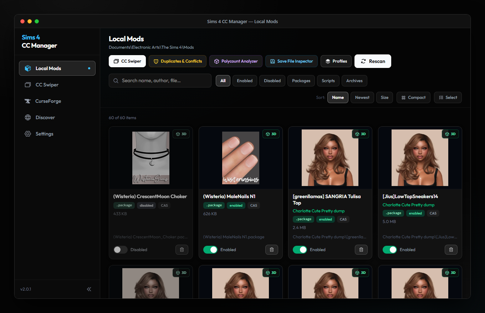
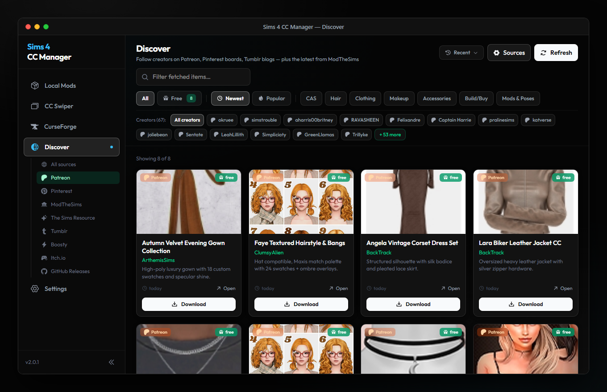
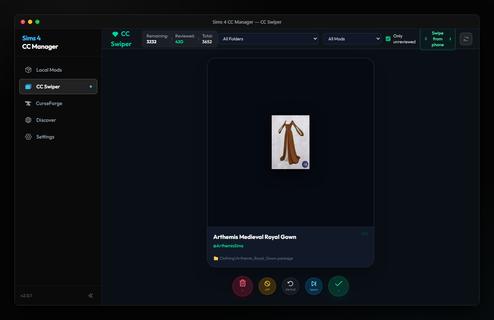
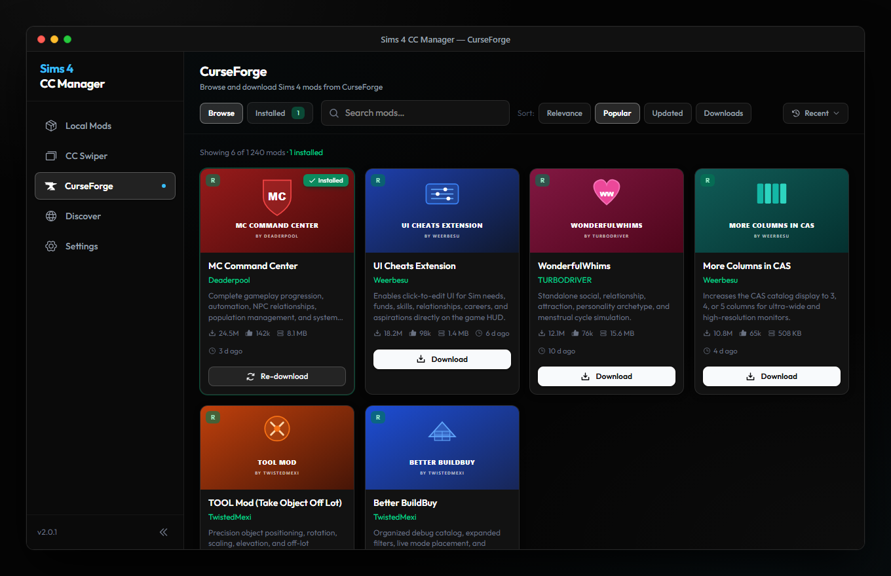
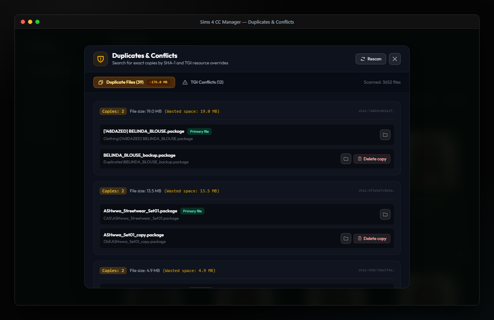
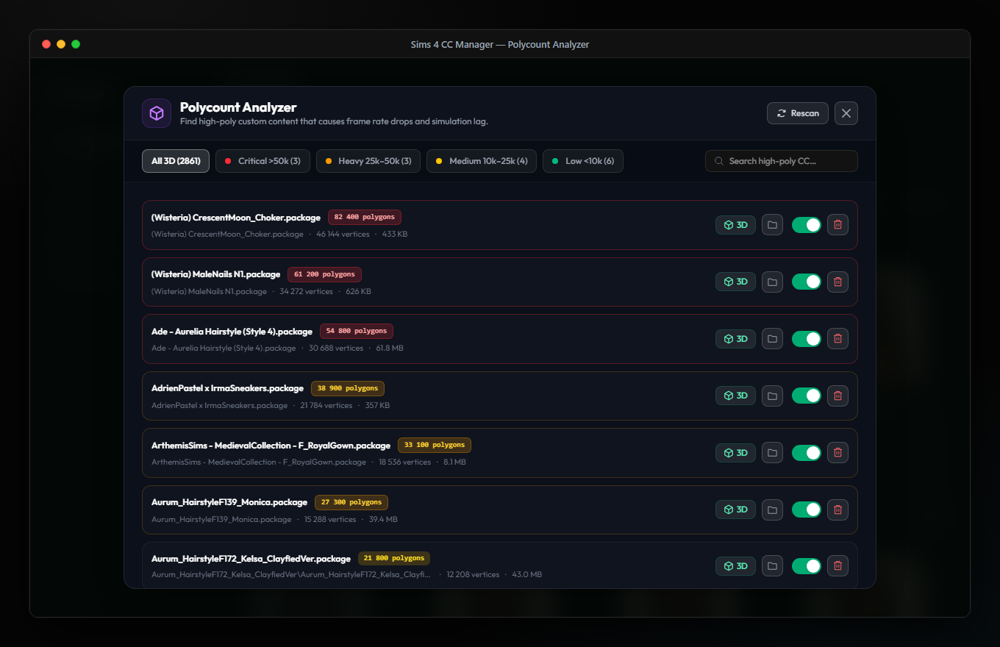
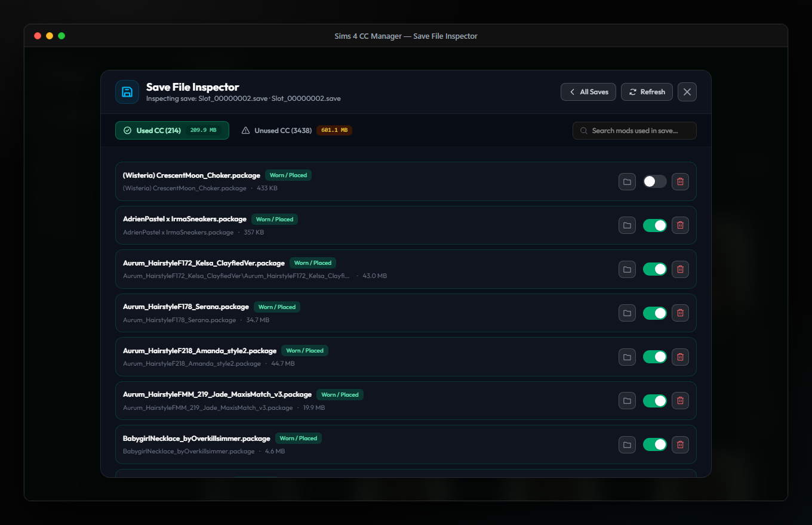
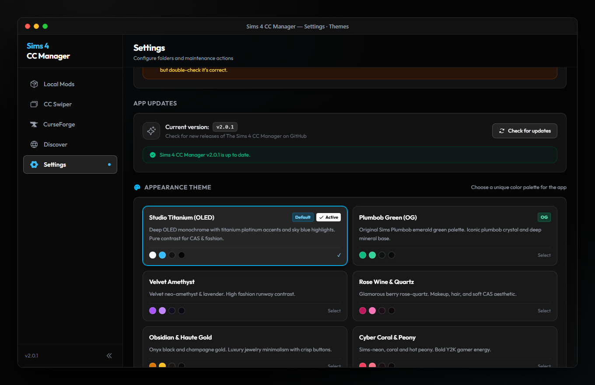

<p align="center">
  
</p>

# Sims 4 CC Manager

A modern desktop application for browsing, installing, organizing, and cleaning custom content and mods for **The Sims 4**.

Version 2.0 is a complete rewrite using **Go, Wails v2, React 18, and Tailwind CSS**. It replaces the legacy Electron runtime with a native Go core: fast cold starts, a lighter memory footprint, and multi-threaded DBPF package parsing that leaves CPU headroom for the rest of your system.

---

## Features

### 1. Local Mods Management
Fast directory scanning, direct DBPF STBL string localization reading, package thumbnail extraction, and one-click enabling/disabling without deleting files.



- **Categorization**: Automatic grouping into Packages, Scripts, Archives, CAS Parts, Build/Buy Objects, and Tuning mods.
- **Enable / Disable Toggle**: Instantly enable or disable mods via extension renaming to isolate broken content.
- **Archive Extraction**: Drag-and-drop `.zip`, `.rar`, and `.7z` archives with automatic extraction and Tray item routing.
- **Mod Profiles**: Save a set of enabled/disabled mods under a name and switch between sets in one click.
- **Package Details**: Inspect internal resources (CASP, GEOM 3D mesh, RLE2 textures, STBL strings) and launch the integrated 3D mesh viewer.

---

### 2. Discover Feed: Patreon, Pinterest, Tumblr and more
An integrated content aggregator: follow your favorite creators and get their new posts in one feed, with a link resolver that unwraps redirect wrappers and link shorteners down to the actual file.



- **Follow Any Creator**: Add creators by name or link on Patreon, Tumblr, Boosty, The Sims Resource, itch.io, GitHub Releases, and Pinterest users or boards.
- **One-Click Downloads**: Resolves SimFileShare, Google Drive, MediaFire, MEGA, Dropbox, Patreon, and CurseForge links to the downloadable file and installs it into `Mods`.
- **Smart Feed Filtering**: Background validation filters out teaser photos and broken links.
- **Creator Blog Support**: Deep link resolution for creator websites (Blogspot, Wix, SeoulSoul, and custom author domains).
- **Paid Stays Paid**: Patron-only and early access posts are marked with a lock and open on Patreon. The app never unlocks paid content.

---

### 3. CC Swiper — Fast Mod Cleaner
A card-swiping interface designed for cleaning bloated custom content collections.



- **Keyboard Controls**: Press `A` (or Left Arrow) to delete, and `D` (or Right Arrow) to keep.
- **Recycle Bin Safety**: Deleted items are moved to the Windows Recycle Bin, with instant undo (`Z`).
- **Mobile Wi-Fi Companion**: Run the embedded local server to swipe and clean mods from your phone or tablet on your local network.
- **Resource Stats**: Polygon counts, texture memory, swatches, and total storage cleaned during the session.

---

### 4. CurseForge Catalog Browser
A full-featured client for the CurseForge mod platform with search, category filtering, and update checks.



- Browse and search gameplay mods, traits, careers, and custom content.
- **Update Checker**: Detects new releases for installed script mods (e.g., MC Command Center, UI Cheats Extension, WonderfulWhims) and updates them in one click.
- Background downloading with automatic extraction into the `Mods` directory.
- **Respects Creators**: When an author disables third-party distribution, the app opens the mod page on CurseForge instead of downloading. An opt-in setting allows direct download at your own risk; it is off by default and shows a warning, because it goes against the author's choice and may get your CurseForge API key revoked.
- Uses your own CurseForge API key (Settings).

---

### 5. Duplicates & Conflicts
Find what silently breaks or bloats your game.



- **Duplicate Scanner**: Finds exact file copies across subfolders by SHA-1 hash and shows how much space they waste.
- **TGI Conflict Detection**: Finds packages that override the same CAS, Object, or Tuning resources.
- **Safe Cleanup**: Copies are removed to the Recycle Bin, not deleted forever.

---

### 6. Polycount Analyzer
Heavy meshes are a common cause of lag in CAS and Live Mode.



- Extracts GEOM meshes and counts polygons for every 3D item, sorted from the heaviest.
- Severity filters: Critical (>50k), Heavy (25k–50k), Medium (10k–25k), Low (<10k).
- Open any item in the 3D viewer, disable it, or move it to the Recycle Bin in one click.

---

### 7. Save File Inspector
See which custom content your saves actually use.



- Reads `.save` files and matches the CAS and Object IDs used by your households and lots.
- Splits your CC into **used** and **unused**, with total sizes, so you can clean up safely.
- Helps catch missing meshes before they turn into in-game glitches.

---

### 8. Themes
Studio Titanium is the default: a neutral OLED monochrome that keeps the colors of your CC true, with every button readable. Prefer a mood? Pick one of the other palettes in Settings.



---

## Architecture & Technology Stack

| Component | Technology | Purpose |
| :--- | :--- | :--- |
| **Backend Core** | Go 1.22+ | DBPF parser, HTTP link resolver, bounded worker pools at below-normal process priority |
| **Desktop Shell** | Wails v2 | Native Windows WebView2 runtime, replacing Electron |
| **Frontend UI** | React 18, Vite | Component architecture, responsive dark UI |
| **Styling** | Tailwind CSS v4 | Theme tokens: Studio Titanium by default plus alternative palettes |
| **3D Rendering** | Three.js | Interactive inspection of CAS and Object GEOM meshes |
| **Localization** | Custom i18n | English and Russian |

---

## System Requirements

- **Operating System**: Windows 10 or Windows 11 (64-bit).
- **Game**: The Sims 4 (EA App, Steam, or custom installation path).
- **Runtime**: Microsoft Edge WebView2 (preinstalled on modern Windows installations).

---

## Installation

1. Download the latest release from the [Releases](https://github.com/268268268/sims4cc/releases) page:
   - `sims4-cc-manager.exe` — Standalone portable executable (no installer required).
   - `sims4-cc-manager-v2.0.1-windows-x64.zip` — Compressed release archive.
2. Launch the application. On first startup, select your `Electronic Arts\The Sims 4\Mods` directory (auto-detected if in standard location).

---

## Building from Source

### Prerequisites
- **Go** (version 1.22 or higher)
- **Node.js** (version 18 or higher) and **npm**
- **Wails CLI v2**:
  ```bash
  go install github.com/wailsapp/wails/v2/cmd/wails@latest
  ```

### Build Steps

```bash
# Clone the repository
git clone https://github.com/268268268/sims4cc.git
cd sims4cc

# Install frontend dependencies
cd frontend
npm install
cd ..

# Build release executable
wails build
```

The resulting binary will be placed at `build/bin/sims4-cc-manager.exe`.

---

## Supported Content Sources

- **Platforms**: Pinterest, Patreon, Tumblr, Boosty, CurseForge, ModTheSims, The Sims Resource, GitHub Releases, itch.io.
- **File Hosts**: SimFileShare, Google Drive, MediaFire, MEGA, Dropbox.
- **Creator Portals**: SeoulSoul, Blogspot, Wix, SimsFinds, and custom author domains.

---

## License

Distributed under the MIT License. This is an independent fan project not affiliated with or endorsed by Electronic Arts or Maxis. All trademarks belong to their respective owners.
